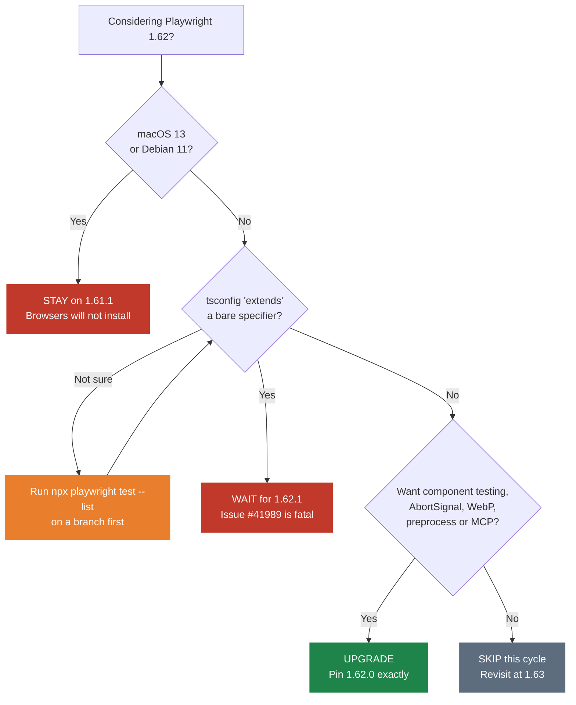

# Playwright 1.62: What Changed, What Broke, and Whether You Should Upgrade

Playwright 1.62 shipped on 24 July 2026. It is the largest API release in about a
year: component testing was rebuilt from scratch, `AbortSignal` landed on 177 option
sites, and the MCP server and coding-agent CLI now ship inside the core package.

It also shipped with a fatal regression that is still open at the time of writing,
and a platform drop that is not mentioned anywhere in the release notes.

This guide covers what changed, what to watch out for, and a straight answer on
whether to upgrade. Every API described here was verified against
`@playwright/test@1.62.0` with runnable tests, which you can find in
[our Playwright releases repo](https://github.com/testdino-hq/playwright-releases).

---

## TL;DR: Playwright 1.62 in 60 Seconds

| What | Why it matters |
| --- | --- |
| **Component testing rebuilt** | `@playwright/experimental-ct-*` is retired. `mount` is a built-in fixture. Your dev server serves a "gallery" page, and tests mount "stories" by id. Works with any framework and any bundler. |
| **`signal: AbortSignal`** | Cancel actions, navigations, waits and assertions from outside. 177 option sites. Racing a success path against an error path is finally clean. |
| **WebP screenshots** | `toHaveScreenshot('home.webp')` stores a lossless baseline roughly 25 to 35 percent smaller than PNG. Change the extension, keep the pixel-exact comparison. |
| **`Reporter.preprocess()`** | Decide which tests run, from outside the test files. Quarantine lists, custom sharding and risk-based selection are now a supported API. |
| **`retryStrategy: 'isolated'`** | Park all retries until the end and run them one at a time in a single worker. |
| **MCP and CLI bundled** | `npx playwright mcp`, `npx playwright cli`, `npx playwright init-skills`. No separate install. |
| **Two blockers** | A fatal tsconfig `extends` regression in monorepos, and Chromium no longer installing on macOS 13. |

**The verdict:** upgrade, unless you are in a monorepo that uses a bare specifier in
`tsconfig.extends`, or you are on macOS 13 or Debian 11. Full breakdown in
[Should You Upgrade](#should-you-upgrade-to-playwright-162).

---

## AI TL;DR

If your interest in this release is the agent story, this is the section to read.
1.62 is the release where Playwright stopped treating AI tooling as a side project
and folded it into the core package.

### Everything now ships in the box

```bash
npx playwright mcp           # the MCP server, previously @playwright/mcp
npx playwright cli           # playwright-cli, for coding agents
npx playwright init-skills   # installs 3 agent skills
npx playwright init-agents   # scaffolds agent config for your editor
```

No separate install, and no version drift between your test runner and your agent
tooling. That second point solved a real problem:
[#41546](https://github.com/microsoft/playwright/issues/41546) reported that
`@playwright/mcp` pinned an exact alpha of `playwright`, which broke lockfile-based
supply-chain pinning in mixed codebases.

### MCP and CLI are now positioned for different jobs

This is the part most teams get wrong, and Playwright is now explicit about it:

| | Playwright MCP | `playwright-cli` |
| --- | --- | --- |
| **Best for** | Long-running autonomous loops that reason iteratively over page structure | Coding agents (Claude Code, Copilot) working inside a large codebase |
| **Cost model** | Loads tool schemas and full accessibility trees into context | Concise CLI commands, snapshots written to files and referenced by path |
| **State** | Persistent session, good for exploratory automation | Named sessions, in-memory profile by default |
| **Use when** | The agent's whole job is driving a browser | Browser work is one part of a task that also involves reading and writing code |

The reasoning behind the split is context economy. A coding agent holding a large
repo in context cannot also afford a verbose accessibility tree on every tool call.
`playwright-cli` writes the snapshot to a file and returns the path, so the agent
pulls in only what it needs.

### The three skills that ship

`npx playwright init-skills` installs into `.claude/skills/`:

| Skill | What it does |
| --- | --- |
| `playwright-cli` | Browser automation through the CLI, with 9 reference docs covering mocking, storage state, tracing, video and test generation |
| `playwright-component-testing` | Sets up the new story gallery for your stack, with React and Vue worked examples and the full gallery contract |
| `playwright-trace` | Inspects `.zip` trace files from the command line: actions, requests, console, errors, snapshots |

The trace skill is quietly the most useful of the three. Debugging a CI failure used
to mean a human downloading a trace and opening the Trace Viewer. An agent can now
read the trace directly and tell you which action failed and what the network did.

### The part to be skeptical about

Playwright's component testing docs now tell you to have a coding agent write your
gallery file, rather than shipping an official one. The community has already pushed
back: [#41996](https://github.com/microsoft/playwright/issues/41996) argues that this
costs time and tokens, is error prone, and leaves every team with a slightly different
gallery depending on which agent wrote it.

That criticism is fair. The gallery is about 50 lines and its contract is stable
enough to package. If you go this route, treat the generated gallery as code you own
and review it properly, because it is now load-bearing infrastructure for your entire
component suite.

### One open AI-adjacent bug

[#41918](https://github.com/microsoft/playwright/issues/41918): Chromium processes
leak when an MCP client disconnects on macOS in VS Code. If you run MCP sessions all
day, keep an eye on your process list.

---

## Should You Upgrade to Playwright 1.62?

**Short answer: yes, but wait for 1.62.1 if you work in a monorepo.**

### Upgrade decision by team profile

| Your situation | Verdict | Why |
| --- | --- | --- |
| tsconfig `extends` with a bare specifier (monorepo, shared config package) | 🔴 **Wait for 1.62.1** | [#41989](https://github.com/microsoft/playwright/issues/41989). Test collection aborts entirely. |
| Dev machines on macOS 13 (Ventura) | 🔴 **Blocked** | Chromium will not install. Not announced. |
| CI on Debian 11 | 🔴 **Blocked** | Officially dropped in this release. |
| Using `@playwright/experimental-ct-react` or `-vue` | 🟢 **Upgrade now** | Old packages still publish at 1.62.0, so nothing breaks. Migrate at your own pace. |
| Large visual-regression suite | 🟢 **Upgrade** | WebP baselines, smaller repo, no behaviour change. |
| Flaky suite leaning on retries | 🟢 **Upgrade** | `retryStrategy: 'isolated'`. |
| Big sharded CI, custom test selection | 🟢 **Upgrade** | `Reporter.preprocess()`. |
| Coding agents or MCP in the loop | 🟢 **Upgrade** | Bundled MCP, CLI and skills. |
| Stable e2e suite, none of the above | ⚪ **Safe to skip** | No bug fix here that you are waiting on. |

### The upgrade decision, as a flowchart



### The two-minute pre-upgrade check

```bash
# 1. Will your tests still be collected?
npx playwright test --list

# 2. Will browsers install on your platform?
npx playwright install --dry-run

# 3. Is your CI base image still supported?
#    Debian 11 is out. Move to Debian 12 or Ubuntu 24.04.
```

If step 1 prints `Failed to resolve "extends" path`, you have hit
[#41989](https://github.com/microsoft/playwright/issues/41989). Stay on 1.61.1.

---

## What's New in Playwright 1.62

### New Playwright Component Testing: Stories and Galleries

The headline change. `@playwright/experimental-ct-react` and
`@playwright/experimental-ct-vue` are retired, and component testing is now a normal
Playwright project pointed at a page your own dev server serves.

**Why the old design never left experimental.** To let you write
`mount(<Button onClick={spy} />)` inside a test, Playwright had to own the whole
pipeline: scan your tests for components, compile a bundle with its own copy of Vite,
serve it from its own server, and marshal props and callbacks between Node and the
browser. That meant path aliases and plugins had to be mirrored by hand into
`ctViteConfig`, webpack and Next.js users were locked out, and callbacks only half
worked because live objects cannot cross the process boundary.

**The new model has three pieces:**

1. **A story** is a small wrapper component pinning one scenario. It lives beside the
   component in `Button.story.tsx`, and each named export is one story.
2. **A gallery** is a single page served by your dev server that exposes
   `window.mount({ story, props })` and `window.unmount()`. It is the only
   framework-specific file, and you own it.
3. **The `mount` fixture** navigates to the gallery, mounts a story by id, and returns
   a `Locator` scoped to `#root`.

```js
import { test, expect } from '@playwright/test';   // note: plain @playwright/test

test('click should expand', async ({ mount }) => {
  const component = await mount('components/Expandable/Stateful');
  await component.getByRole('button').click();
  await expect(component.getByTestId('expanded')).toHaveValue('true');
});
```

**The pattern that replaces spies.** Instead of passing a callback from Node, the
story owns the callback and records the outcome into a hidden input. The test then
asserts on that input with a retrying web-first assertion:

```js
// Button.story.tsx
export const CountsClicks = () => {
  const [clicks, setClicks] = useState(0);
  return <>
    <Button title='Submit' onClick={() => setClicks(c => c + 1)} />
    <form hidden><input data-testid='click-count' readOnly value={String(clicks)} /></form>
  </>;
};
```

```js
// button.spec.ts
await component.getByRole('button').click();
await expect(component.getByTestId('click-count')).toHaveValue('1');
```

This looks like a workaround at first and turns out to be better. The whole scenario
runs in the browser, so there is no boundary to leak through. The recorded state is
visible when you open the story in a browser, so the story doubles as a manual test
page for the exact scenario your automated test covers.

**What to watch for when migrating:**

- Story ids are strings, so renaming a story breaks specs at runtime rather than at
  compile time. Use `mount<typeof Story>` to at least type-check the props.
- Per-test JSX is gone. A test that built a different tree per case becomes one story
  export per composition.
- Migration can be incremental. The experimental packages still publish at 1.62.0, so
  run both projects side by side and port spec by spec.

### AbortSignal Support Across the Playwright API

Most operations and web-first assertions now accept a `signal`:

```js
const controller = new AbortController();
setTimeout(() => controller.abort(), 1000);

await page.getByRole('button', { name: 'Submit' }).click({ signal: controller.signal });
await expect(page.getByText('Done')).toBeVisible({ signal: controller.signal });
```

The mental model that makes this click: **a timeout answers "how long may this call
take?", and a signal answers "is this call still worth making?"**. The second answer
can come from anywhere, including another promise settling.

The pattern worth copying is racing two outcomes and cancelling the loser, rather
than letting it sit there burning a 30 second timeout:

```js
const controller = new AbortController();
const { signal } = controller;

const winner = await Promise.any([
  expect(page.getByTestId('status')).toHaveText('Ready', { signal }).then(() => 'ready'),
  expect(page.getByRole('alert')).toBeVisible({ signal }).then(() => 'error'),
]);
controller.abort();
```

One gotcha: a signal does not disable the default timeout. Both clocks run, and
whichever fires first wins. Pass `timeout: 0` if the signal should be the only thing
that can stop the call.

### WebP Screenshots and Smaller Visual Baselines

```js
await expect(page).toHaveScreenshot('homepage.webp');           // lossless
await page.screenshot({ path: 'debug.webp', quality: 50 });     // lossy
```

The `quality` value decides everything:

- `100`, the default, produces **lossless** WebP. Safe for visual baselines, and
  roughly 25 to 35 percent smaller than the equivalent PNG.
- Anything below `100` produces **lossy** WebP. Good for trace attachments and debug
  artifacts. Never use it for a baseline, because the compression noise will produce
  false diffs.

For a suite with hundreds of baselines, switching the extension is the cheapest repo
size win available in this release.

### Reporter.preprocess(): Choosing Which Tests Run

This got one short paragraph in the release notes and deserves much more.
`preprocess()` runs after config resolution and before `onBegin()`, and gives your
reporter the entire suite plus a `TestRun` control object:

```js
class QuarantineReporter {
  async preprocess({ config, suite, testRun }) {
    for (const test of suite.allTests()) {
      if (isQuarantined(test))
        testRun.skip(test, 'Blocked on PROJ-4412');
    }
  }
}
```

| Method | Runs? | In report? | Meaning |
| --- | --- | --- | --- |
| `skip(test, reason)` | No | Yes, as skipped | Not now |
| `fixme(test, reason)` | No | Yes, as skipped | Broken, intend to fix |
| `fail(test, reason)` | **Yes** | Passes only if it fails | Documented bug |
| `exclude(test)` | No | No, absent entirely | Not part of this run |
| `skipSharding()` | n/a | n/a | Reporter owns sharding |

**Why this matters more than it looks.** Before 1.62, deciding which tests run from
outside the files meant `--grep` with the answer encoded in test titles, a
`test.skip()` and a pull request per quarantine, or a homegrown global-setup hack.

Two details make real tooling possible:

1. The suite already reflects `--project`, `--grep` and `.only`.
2. The suite **ignores `--shard`**, so you see the whole corpus before sharding. That
   is what lets a reporter implement its own sharding: by historical duration, by
   changed files, by failure risk.

**`fail()` is the best of the four.** It runs the test and requires it to fail. The
day someone fixes the underlying bug, your suite turns red and tells you to delete the
quarantine entry. A skip list rots silently for months. A `fail()` list cannot.

One trap we hit while testing this: passing `--reporter=list` on the command line
**replaces** your configured reporters, which silently disables your `preprocess()`
reporter. There is an open request to add an append option
([#41990](https://github.com/microsoft/playwright/issues/41990)).

### Isolated Retries with retryStrategy

```js
export default defineConfig({
  retries: 2,
  retryStrategy: 'isolated',
});
```

The default, `'immediate'`, retries a failed test as soon as a worker frees up,
interleaved with everything else. `'isolated'` parks every retry until the end, then
runs them one at a time in a single worker.

You pay in total wall-clock time. You get back two things: a flaky test can no longer
disturb a healthy test that happened to share its worker, and your retry results
become cleaner evidence about whether a test is genuinely flaky or was just a victim
of its neighbour.

### Smaller Playwright 1.62 APIs Worth Knowing

**`scroll: 'none'`** makes an action fail unless the element is already in the
viewport. Playwright has always scrolled elements into view, which is right for
testing behaviour and wrong for testing reachability. A CTA 1500px below the fold
passes every click test you write. One `click({ scroll: 'none', trial: true })` per
critical CTA at each viewport is cheaper and more stable than a full-page visual diff.

**`apiResponse.timing()`** gives resource timing for API responses, so a latency
budget can live next to your functional assertions:

```js
const { requestStart, responseStart } = (await request.get('/api/items')).timing();
expect(responseStart - requestStart).toBeLessThan(1000);
```

Watch for two things: redirected requests report the last hop only, and HAR replay
returns `-1` for every field. Connection reuse also legitimately yields `-1` for DNS
and TLS phases, so skip `-1` rather than treating it as zero.

**`locator.waitForFunction()`** waits until a function returns truthy, called with the
matching element. Unlike `page.waitForFunction()`, it re-resolves the locator on every
retry, so a framework re-render mid-wait is tolerated for free. Use it for conditions
that live on the element but not in the markup: computed style, layout box, scroll
position, canvas contents.

**`storageState({ credentials: true })`** puts WebAuthn passkeys into saved storage
state. 1.61 introduced the virtual authenticator, but credentials died with the
context, so every passkey test re-registered before it could sign in. Now you register
once in a setup project and every worker restores it. Note that the saved credentials
carry their private keys, so treat that file as a secret and keep it out of report
attachments.

**HTML reporter `mergeFiles`** turns the "Merge files" grouping from a toggle you
click every time into a config option that survives CI.

### The Feature the Release Notes Undersold: exposeFunctions

The release notes say `page.evaluate()` and `addInitScript()` "now accept functions as
evaluate arguments". Reading that, you would assume the function's source gets
transferred and runs in the browser. It does not, and passing a function still throws
`Attempting to serialize unexpected value` unless you opt in:

```js
const seen = [];

const result = await page.evaluate(
    async ({ values, double }) => {
      const out = [];
      for (const v of values) out.push(await double(v));   // async in the browser
      return out;
    },
    { values: [1, 2, 3], double: n => { seen.push(n); return n * 10; } },
    { exposeFunctions: true });

// result is [10, 20, 30], and seen is [1, 2, 3] on the Node side
```

What actually happens: any function anywhere in the argument becomes a proxy in the
browser, and calling it calls back into Node. The body runs in Node, keeps its
closure, and returns a Promise. It is `page.exposeFunction()` without the global name,
without the setup call and without the teardown.

Two rules. The proxy is always async in the browser even when the Node function is
synchronous. And nothing works unless you pass `{ exposeFunctions: true }`.

This is also the escape hatch for component testing when a hidden-input recording is
not enough and you really do need a spy installed before app code runs.

One more thing that is not in the release notes at all: `addInitScript()` now returns a
`Disposable`, so init scripts can be scoped instead of living for the whole context:

```js
{
  await using clock = await page.addInitScript(() => { Date.now = () => 1_700_000_000_000; });
  await page.goto('/');
}
// removed on scope exit, even if an assertion threw
```

---

## Playwright 1.62 Breaking Changes and Known Issues

| Item | Status | Impact |
| --- | --- | --- |
| Debian 11 support dropped | Announced | Move CI images to Debian 12 or Ubuntu 24.04 |
| **Chromium will not install on macOS 13** | **Not announced** | `npx playwright install chromium` fails with *"does not support chromium on mac13-arm64"*. 1.61.1 installs fine on the same machine. |
| tsconfig `extends` bare specifier | 🔴 Open, [#41989](https://github.com/microsoft/playwright/issues/41989) | Fatal. Test collection aborts. Fix PR [#41997](https://github.com/microsoft/playwright/pull/41997) is open but unmerged. |
| Docker images missing at release | ✅ Resolved | `v1.62.0-noble` was absent for about 24 hours ([#41987](https://github.com/microsoft/playwright/issues/41987)). Published now. |
| `--reporter` replaces config reporters | By design, [#41990](https://github.com/microsoft/playwright/issues/41990) | Silently disables a `preprocess()` reporter |
| `@playwright/experimental-ct-*` | Superseded, not deprecated on npm | Still publishes at 1.62.0. No forced migration. |

### The macOS 13 issue in detail

This one is worth spelling out because it is not documented. On a macOS 13 arm64
machine:

```
$ npx playwright install chromium     # @playwright/test@1.62.0
Failed to install browsers
Error: ERROR: Playwright does not support chromium on mac13-arm64

$ npx playwright install chromium     # @playwright/test@1.61.1
Chrome for Testing 149.0.7827.55 (playwright chromium v1228)   ✓
```

WebKit dropped macOS 13 in an earlier release and that was announced. Chromium
dropping it in 1.62 was not. If your team has anyone on Ventura, they will be unable
to run the suite locally after the upgrade. Your options are to stay on 1.61.1, upgrade
macOS, or run against installed Google Chrome with `use: { channel: 'chrome' }`.

### Browser versions in Playwright 1.62

| Browser | Version |
| --- | --- |
| Chromium | 151.0.7922.34 |
| Firefox | 153.0 |
| WebKit | 26.5 |

Also tested against Google Chrome 151 and Microsoft Edge 151.

---

## Try Playwright 1.62 Yourself: Runnable Examples

Reading a changelog tells you what shipped. Running it tells you what it does. We
maintain [`playwright-releases`](https://github.com/testdino-hq/playwright-releases),
a repo that distils each Playwright release into two things:

- **A release breakdown** with Mermaid diagrams, an upgrade or skip verdict, and the
  API changes that matter day to day.
- **A folder of runnable examples**, one spec per feature, that actually pass against
  the real published package.

Nothing in that repo is pseudo-code. The 1.62 folder runs 45 tests against
`@playwright/test@1.62.0`: 44 passing and 1 intentionally skipped by the quarantine
reporter, so you can see each API behave rather than take our word for it.

```bash
git clone https://github.com/testdino-hq/playwright-releases
cd playwright-releases/1.62/examples
npm install
npx playwright install chromium
npm test
```

### What is inside the 1.62 examples folder

| Spec | Feature it proves |
| --- | --- |
| `01-abort-signal.spec.ts` | Signals on actions and assertions, racing two outcomes, `timeout: 0` |
| `02-webp-screenshots.spec.ts` | Lossless vs lossy WebP with real byte-size output, `.webp` baselines |
| `03-locator-wait-for-function.spec.ts` | Locator re-resolution, waiting on computed layout |
| `04-scroll-none.spec.ts` | Above-the-fold assertions at multiple viewports |
| `05-api-response-timing.spec.ts` | Phase breakdown, TTFB budgets, the `-1` trap |
| `06-evaluate-functions.spec.ts` | `exposeFunctions`, Node-side callbacks, disposable init scripts |
| `07-storage-state-credentials.spec.ts` | Passkey persistence, and proof the private key is in the file |
| `08-preprocess-quarantine.spec.ts` | A working quarantine reporter using `skip` and `fail` |
| `tests/components/*.spec.ts` | Stories, galleries, `update()` preserving state, route mocking |

The component-testing example is worth a look even if you skip everything else. It
includes **a complete working gallery in about 50 lines of plain DOM with no bundler
at all**, which makes the contract much easier to understand than a framework-specific
version. Once you can see what `window.mount` has to do, porting it to React, Vue or
Svelte is straightforward.

Older releases live in the same repo under `1.60/` and `1.61/`, in the same shape.

---

## Frequently Asked Questions

### Is Playwright 1.62 stable enough for production CI?

For most teams, yes. The two blockers are narrow and easy to test for in two minutes:
run `npx playwright test --list` to check the tsconfig regression, and
`npx playwright install --dry-run` to check platform support. If both pass, 1.62 is a
normal upgrade.

### Do I have to migrate off @playwright/experimental-ct-react right now?

No. The experimental packages still publish at 1.62.0, so upgrading Playwright does not
break your existing component tests. Set up a gallery and a second project, port specs
gradually, and drop the old dependency when you are done.

### Will WebP baselines break my existing visual tests?

Only if you rename them. Existing `.png` baselines keep working exactly as before.
WebP applies to snapshots you explicitly name `.webp`, and at the default quality of
100 the comparison is still pixel-exact.

### What is the difference between Playwright MCP and playwright-cli?

MCP suits long-running autonomous agents that reason iteratively over page structure
and benefit from persistent session state. `playwright-cli` suits coding agents that
are also holding a large codebase in context, because CLI commands avoid loading big
tool schemas and full accessibility trees into the model's context window.

### Does retryStrategy: 'isolated' make my CI slower?

Yes, somewhat, because retries no longer overlap with the rest of the run. The trade is
deliberate: you spend wall-clock time to get retry results that are not contaminated by
whatever else was running in the same worker.

---

## Related Reading

- [Playwright 1.62 release notes](https://playwright.dev/docs/release-notes#version-162)
- [`Reporter.preprocess()` API reference](https://playwright.dev/docs/api/class-reporter#reporter-preprocess)
- [Component testing guide](https://playwright.dev/docs/test-components)
- [Our 1.62 release breakdown with diagrams](./readme.md)
- [Runnable 1.62 examples](./examples)
