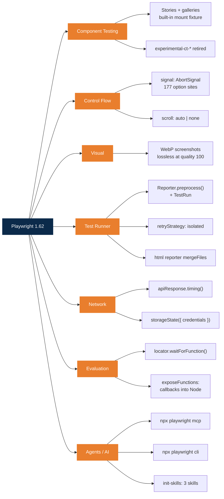
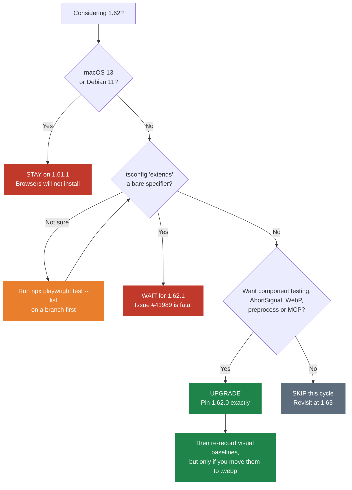
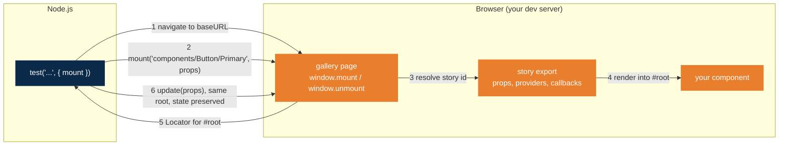
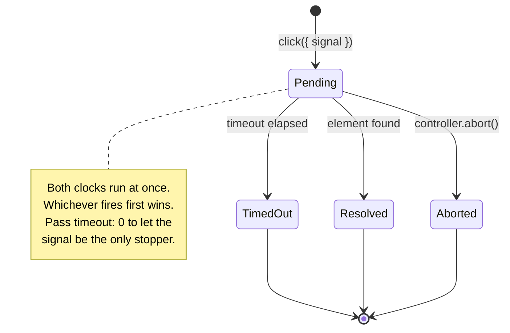
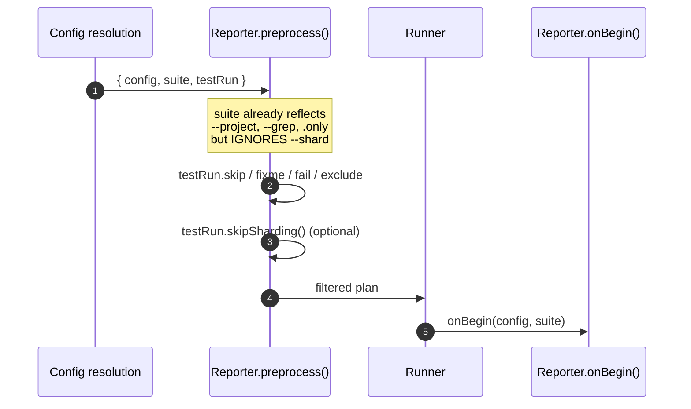
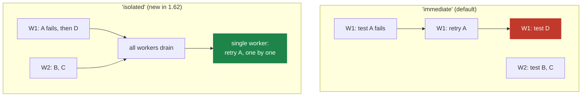

# Playwright 1.62 Release Notes

**Released:** 24 July 2026 · **Source:** <https://playwright.dev/docs/release-notes#version-162>

Verified against `@playwright/test@1.62.0`. Every API in this document is exercised
by a passing test in [`examples/`](./examples). Last full run: 44 passed, 1 skipped,
0 failed.

---

## What's New at a Glance



---

## Should You Upgrade?

**Short answer: yes, but wait for 1.62.1 if you work in a monorepo.**

1.62 is a strong release. The component-testing rewrite and `AbortSignal` are the
two largest API additions in a year. It also shipped with one fatal regression that
is still unfixed as of 27 July 2026, and one platform drop that is not in the
release notes.

### By team profile

| Your situation | Verdict | Why |
| --- | --- | --- |
| tsconfig `extends` with a bare specifier (monorepo, shared config package) | 🔴 **Wait for 1.62.1** | [#41989](https://github.com/microsoft/playwright/issues/41989). Test collection aborts with `Failed to resolve "extends" path`. Fix PR [#41997](https://github.com/microsoft/playwright/pull/41997) is open, not merged. |
| Dev machines on macOS 13 (Ventura) | 🔴 **Blocked** | `npx playwright install chromium` fails with *"does not support chromium on mac13-arm64"*. Not announced anywhere. Stay on 1.61.1 or upgrade macOS. |
| CI on Debian 11 | 🔴 **Blocked** | Officially dropped. Move to Debian 12 or Ubuntu 24.04 first. |
| On `@playwright/experimental-ct-react` or `-vue` | 🟢 **Upgrade now** | The old packages still publish at 1.62.0, so nothing breaks on upgrade. Migrate spec by spec at your own pace. |
| Large visual-regression suite | 🟢 **Upgrade** | WebP baselines are lossless and roughly 25 to 35 percent smaller. Repo-size win for a one-character change to the file extension. |
| Flaky suite leaning on `retries` | 🟢 **Upgrade** | `retryStrategy: 'isolated'` stops a retrying test from disturbing its worker neighbours. |
| Big sharded CI, custom test selection | 🟢 **Upgrade** | `Reporter.preprocess()` makes quarantine lists and custom sharding a supported API instead of a hack. |
| Coding agents or MCP in the loop | 🟢 **Upgrade** | MCP server, `playwright-cli` and three agent skills now ship in the box. |
| Stable e2e suite, none of the above | ⚪ **Safe to skip** | Nothing here is a bug fix you are waiting on. Pick it up at 1.62.1 or 1.63. |

### Decision path



---

## Major Features

### 1. Component testing, rebuilt around stories and galleries

The `@playwright/experimental-ct-*` packages are retired. There is no
component-testing runtime any more, no bundler integration, and no extra npm
package. `mount` is now a built-in fixture of `@playwright/test`.

The old design required Playwright to own your whole pipeline: scan tests for
components, compile a bundle with its own copy of Vite, serve it, and marshal props
and callbacks across the Node and browser boundary. That is why it stayed
experimental for four years. Aliases and plugins had to be mirrored by hand into
`ctViteConfig`, webpack and Next.js users were locked out, and callbacks only half
worked.

The new model inverts control:



Three concepts, and only one of them is new work for you:

- A **story** is a small wrapper component pinning one scenario: hard-coded props,
  mock data, providers, recorded callbacks. It lives next to the component in
  `Button.story.tsx`, and each named export is one story.
- The **gallery** is a single page served by *your own dev server* that exposes
  `window.mount({ story, props })` and `window.unmount()`. It is framework-specific
  and it is yours to own. This is the one file you write, once.
- The **`mount` fixture** navigates to the gallery, calls `window.mount`, and returns
  a `Locator` scoped to `#root`.

The pattern that replaces `mount(<Button onClick={spy} />)`: the story owns the
callback and records the outcome into a hidden input, and the test asserts on it with
a retrying web-first assertion.

```js
// Button.story.tsx, runs in the browser, so nothing is marshalled
export const CountsClicks = () => {
  const [clicks, setClicks] = useState(0);
  return <>
    <Button title='Submit' onClick={() => setClicks(c => c + 1)} />
    <form hidden><input data-testid='click-count' readOnly value={String(clicks)} /></form>
  </>;
};
```

```js
// button.spec.ts, plain @playwright/test
test('counts clicks', async ({ mount }) => {
  const component = await mount('components/Button/CountsClicks');
  await component.getByRole('button').click();
  await expect(component.getByTestId('click-count')).toHaveValue('1');
});
```

**Migration map:**

| `@playwright/experimental-ct-*` | Story gallery |
| --- | --- |
| `mount(<Button onClick={spy} />)` | Story provides `onClick`, records into a hidden input |
| `component.update(<Button count={2} />)` | `component.update({ count: 2 })` |
| `beforeMount` and `afterMount` | The body of your gallery's `window.mount` |
| `hooksConfig` per test | Props: `mount('App/Routing', { route: '/dashboard' })` |
| `ctViteConfig`, `ctPort`, `ctTemplateDir` | Gone. Your dev server, your config. |
| `defineConfig` from the ct package | Plain `defineConfig` from `@playwright/test` |

The catch worth flagging: **story ids are strings**, so renaming a story breaks specs
at runtime rather than compile time. `mount<typeof Story>` at least ties the props to
the story type.

> Playwright's own docs tell you to have a coding agent write the gallery
> (`npx playwright init-skills`). The community has already pushed back on that as
> the default onboarding path. See
> [#41996](https://github.com/microsoft/playwright/issues/41996), which asks for an
> official `playwright-gallery/*` package.

### 2. AbortSignal on 177 option sites

Most operations, navigations, waits and web-first assertions now take a `signal`:

```js
const controller = new AbortController();
setTimeout(() => controller.abort(), 1000);

await page.getByRole('button', { name: 'Submit' }).click({ signal: controller.signal });
await expect(page.getByText('Done')).toBeVisible({ signal: controller.signal });
```

The distinction that matters: **a timeout answers "how long may this call take?", and
a signal answers "is this call still worth making?"**. That second answer can come
from somewhere else entirely.



The pattern that pays for itself is racing a happy path against an error path and
cancelling the loser, instead of letting it burn a full 30 second timeout:

```js
const controller = new AbortController();
const { signal } = controller;

const winner = await Promise.any([
  expect(page.getByTestId('status')).toHaveText('Ready', { signal }).then(() => 'ready'),
  expect(page.getByRole('alert')).toBeVisible({ signal }).then(() => 'error'),
]);
controller.abort();  // the loser stops immediately
```

⚠️ A signal does **not** disable the default timeout. Pass `timeout: 0` if you want
the signal to be the only thing that can stop the call.

### 3. WebP screenshots

```js
await expect(page).toHaveScreenshot('homepage.webp');           // lossless golden
await page.screenshot({ path: 'homepage.webp', quality: 50 });  // lossy, much smaller
```

One rule decides whether this is safe:

| `quality` | Result | Use for |
| --- | --- | --- |
| `100` (default) | **Lossless** WebP | Visual baselines. Pixel-exact comparison, roughly 25 to 35 percent smaller than PNG. |
| below `100` | **Lossy** WebP | Trace attachments, debug artifacts, report screenshots. Never a baseline. |

`page.screenshot()` and `locator.screenshot()` also accept `type: 'webp'` explicitly.

### 4. Reporter.preprocess(), deciding what runs from outside the tests

This is the most under-sold feature in the release. `preprocess()` runs after config
resolution and before `onBegin()`, and hands you the whole suite plus a `TestRun`:



| `TestRun` method | Executed? | In the report? | Meaning |
| --- | --- | --- | --- |
| `skip(test, reason)` | No | Yes, as skipped | Not now |
| `fixme(test, reason)` | No | Yes, as skipped | Broken, intend to fix |
| `fail(test, reason)` | **Yes** | Yes, and passes only if it fails | Documented bug |
| `exclude(test)` | No | **No**, absent entirely | Not part of this run |
| `skipSharding()` | n/a | n/a | You own sharding, not Playwright |

Two facts shape what you can build on this:

1. The suite already reflects `--project`, `--grep` and `.only`.
2. The suite **ignores `--shard`**, so you see the whole corpus before sharding. That
   is precisely what makes reporter-driven sharding possible for the first time:
   by historical duration, by changed files, by risk.

`fail()` is the quietly excellent one. It runs the test and requires it to fail, so
the day someone fixes the underlying bug your suite turns red and tells you to delete
the quarantine entry. A skip list rots silently. A `fail()` list cannot.

> ⚠️ Gotcha found while testing this: passing `--reporter=list` on the CLI
> **replaces** your configured reporters, so a `preprocess()` reporter silently stops
> running. There is an open request to change that:
> [#41990](https://github.com/microsoft/playwright/issues/41990).

### 5. retryStrategy: 'isolated'

```js
export default defineConfig({ retries: 2, retryStrategy: 'isolated' });
```



Retries stop interleaving with the main suite. The cost is total wall-clock time. The
benefit is that a flaky test can no longer disturb a healthy neighbour that happened
to share its worker, and that your retry results become cleaner evidence of whether
the test is genuinely flaky.

---

## Smaller APIs Worth Knowing

### scroll: 'auto' | 'none'

Playwright has always scrolled an element into view before acting on it. That is right
for testing behaviour and wrong for testing reachability. A "Buy now" button 1500px
below the fold passes every click test you write.

```js
await cta.click({ scroll: 'none' });                 // fails unless already in viewport
await cta.click({ scroll: 'none', trial: true });    // assert reachability, do not click
```

One `trial: true` assertion per critical CTA, at each viewport you care about, is
cheaper and more stable than a full-page visual diff for catching "the CTA moved off
screen on mobile".

### apiResponse.timing()

Resource timing for API responses, matching what `request.timing()` has always given
browser requests. `startTime` is absolute, and every other phase is relative to it.

```js
const { requestStart, responseStart } = (await request.get('/api/items')).timing();
expect(responseStart - requestStart).toBeLessThan(1000);   // time-to-first-byte budget
```

Two caveats. Redirected requests report the **last hop only**, and HAR replay returns
`-1` for every field. Connection reuse also legitimately yields `-1` for DNS and TLS
phases, so a real budget check must skip `-1` rather than treat it as zero.

### locator.waitForFunction()

```js
await menu.waitForFunction(element => element.hasAttribute('aria-expanded'));
```

`page.waitForFunction()` has always been the escape hatch, but it hands you no
element. You re-query with `querySelector` inside the browser, and that query goes
stale the moment the framework re-renders. `locator.waitForFunction()` **re-resolves
the locator on every retry** and calls your function with the matching element, so
re-renders are tolerated for free.

It earns its keep on conditions that live on the element but not in the markup:
computed style, layout box, scroll position, media state, canvas contents. It returns
`Promise<void>` rather than a handle, so chain `locator.evaluate()` when you want the
value.

### exposeFunctions, the most under-described feature in the release

The release notes say only that `evaluate()` and `addInitScript()` "accept functions
as arguments". That undersells it badly. Passing a function still throws
`Attempting to serialize unexpected value`, until you opt in:

```js
const seen = [];

const result = await page.evaluate(
    async ({ values, double }) => {
      const out = [];
      for (const v of values) out.push(await double(v));   // async in the browser
      return out;
    },
    { values: [1, 2, 3], double: n => { seen.push(n); return n * 10; } },
    { exposeFunctions: true });

// result is [10, 20, 30] and seen is [1, 2, 3]
```

Any function anywhere in the argument becomes a proxy in the browser. Calling it
**calls back into Node**. The body runs in Node, keeps its closure, and returns a
Promise. It is `page.exposeFunction()` without the global name, without the setup
call, and without the teardown.

Two rules. The proxy is always **async** in the browser even when the Node function is
synchronous, and you must pass `{ exposeFunctions: true }` or nothing changes.

This is also the missing piece for the new component-testing model. When you genuinely
need a spy rather than a hidden-input recording, an init script with `exposeFunctions`
gives you one that is installed before any app code runs.

### addInitScript() returns a Disposable

Not in the release notes at all. Init scripts used to be permanent once installed.
Now they can be scoped:

```js
{
  await using clock = await page.addInitScript(() => { Date.now = () => 1_700_000_000_000; });
  await page.goto('/');
  // clock is frozen here
}
// removed on scope exit, even if an assertion threw
```

### storageState({ credentials: true })

1.61 gave tests a virtual WebAuthn authenticator, but credentials died with the
context, so every passkey test had to re-register before it could sign in. Now
passkeys are part of the saved state, and the standard auth-setup-project pattern
works for passkeys exactly as it does for cookies.

```js
await context.storageState({ path: 'auth.json', credentials: true });
// A context restored from auth.json auto-installs the authenticator.
// Do NOT call credentials.install() again.
```

⚠️ **The saved credentials carry their private keys.** Treat that file as a secret:
gitignore it, and keep it out of report attachments and trace uploads.

### HTML reporter mergeFiles

```js
reporter: [['html', { mergeFiles: true }]],
```

The "Merge files" grouping was previously a toggle you had to click every time. As a
config option, the grouping now survives CI and reaches your teammates.

---

## Agents and AI

See the [blog post](./BLOG.md#ai-tldr) for the full treatment. In short, 1.62 folds
the agent tooling into the core package:

| Command | What it does |
| --- | --- |
| `npx playwright mcp` | The Playwright MCP server, with no separate `@playwright/mcp` install |
| `npx playwright cli` | `playwright-cli`, token-efficient browser control for coding agents |
| `npx playwright init-skills` | Installs 3 agent skills: `playwright-cli`, `playwright-component-testing`, `playwright-trace` |
| `npx playwright init-agents` | Scaffolds agent config for claude, codex, copilot, opencode or vscode |

The framing Playwright now uses: **MCP for long-running autonomous loops that benefit
from persistent state, and `playwright-cli` for coding agents**, because CLI commands
avoid loading large tool schemas and verbose accessibility trees into a limited
context window.

---

## Breaking Changes and Known Issues

| Item | Status | Impact |
| --- | --- | --- |
| Debian 11 dropped | Announced | CI images must move to Debian 12 or Ubuntu 24.04 |
| **macOS 13 Chromium install fails** | **Not announced** | `npx playwright install chromium` errors with *"does not support chromium on mac13-arm64"*. 1.61.1 installs fine. Verified on Darwin 22.1.0. |
| tsconfig `extends` bare specifier | 🔴 Open, [#41989](https://github.com/microsoft/playwright/issues/41989) | Fatal. Test collection aborts. Hits monorepos with a shared config package, and any `extends` that resolves through an `exports` alias. Fix PR [#41997](https://github.com/microsoft/playwright/pull/41997) is open. |
| Docker images missing at release | ✅ Resolved | `mcr.microsoft.com/playwright:v1.62.0-noble` was absent for roughly 24 hours after release ([#41987](https://github.com/microsoft/playwright/issues/41987)). Now published. |
| `--reporter` CLI flag replaces config reporters | Working as designed, [#41990](https://github.com/microsoft/playwright/issues/41990) | Silently disables a `preprocess()` reporter |
| `@playwright/experimental-ct-*` | Superseded, **not** deprecated on npm | Still publishes at 1.62.0. No forced migration. |

### Browser versions

| Browser | Version |
| --- | --- |
| Chromium | 151.0.7922.34 |
| Firefox | 153.0 |
| WebKit | 26.5 |

Also tested against Google Chrome 151 and Microsoft Edge 151.

---

## Examples

Everything above is exercised by a passing test in [`examples/`](./examples):

```bash
cd examples
npm install
npx playwright install chromium
npm test
```

| Spec | Feature | Script |
| --- | --- | --- |
| `01-abort-signal.spec.ts` | `signal` on actions and assertions, racing, `timeout: 0` | `npm run abort` |
| `02-webp-screenshots.spec.ts` | Lossless vs lossy WebP, size comparison, `.webp` baselines | `npm run webp` |
| `03-locator-wait-for-function.spec.ts` | `locator.waitForFunction()`, re-resolution, layout conditions | `npm run waitfor` |
| `04-scroll-none.spec.ts` | `scroll: 'none'` as an above-the-fold assertion | `npm run scroll` |
| `05-api-response-timing.spec.ts` | `apiResponse.timing()`, TTFB budgets, the `-1` trap | `npm run timing` |
| `06-evaluate-functions.spec.ts` | `exposeFunctions`, Node-side callbacks, `Disposable` init scripts | `npm run evaluate` |
| `07-storage-state-credentials.spec.ts` | Passkeys in storage state, private-key warning | `npm run passkeys` |
| `08-preprocess-quarantine.spec.ts` | Reporter-driven quarantine using `skip` and `fail` | `npm run quarantine` |
| `tests/components/*.spec.ts` | Stories, galleries, `update()`, routing, visual | `npm run components` |

Also in the folder:

- `site/playwright/gallery/main.js`, a complete working gallery in about 50 lines of
  plain DOM with no bundler. The React and Vue variants live in the shipped
  `playwright-component-testing` skill.
- `reporters/quarantine-reporter.ts`, a `preprocess()` reporter driven by
  `quarantine.json`. Run `npm run quarantine:off` to see the same suite without it.
- `playwright.config.ts`, showing `retryStrategy: 'isolated'`, `mergeFiles`, and the
  two-project layout (e2e plus components).

> **Note for macOS 13 users:** these examples cannot install Playwright 1.62's
> Chromium. They were verified against installed Google Chrome via
> `use: { channel: 'chrome' }`.

---

## Deeper Reading

- [The 1.62 blog post](./BLOG.md), the narrative version with the AI TL;DR and the
  full upgrade argument.
- [Official release notes](https://playwright.dev/docs/release-notes#version-162)
- [`Reporter.preprocess()` API](https://playwright.dev/docs/api/class-reporter#reporter-preprocess)
- [Component testing guide](https://playwright.dev/docs/test-components)
