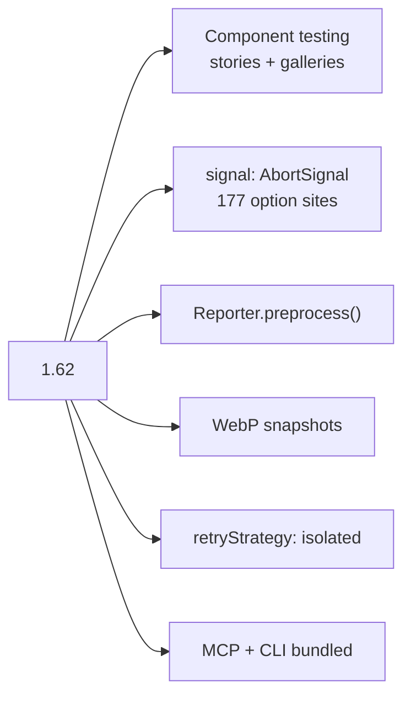
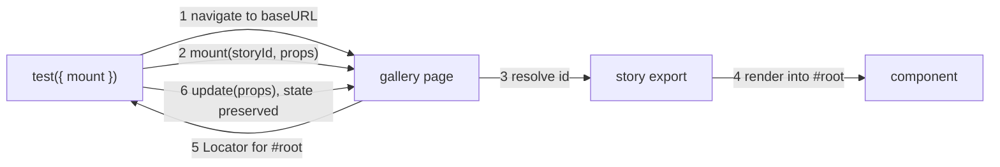
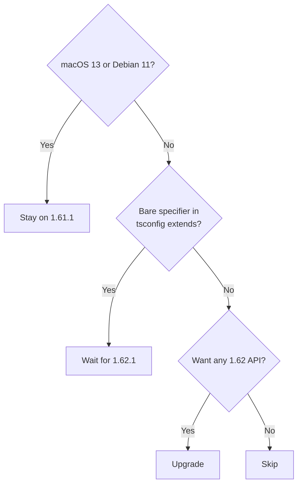
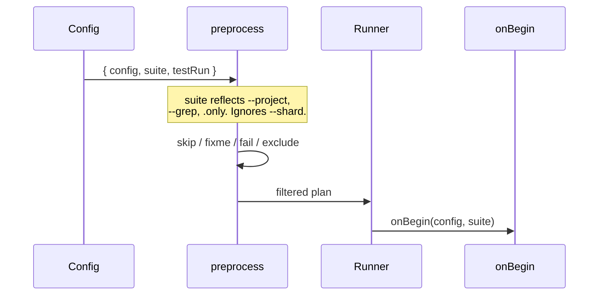

# Playwright 1.62

Runnable examples for every API added in 1.62, verified against
`@playwright/test@1.62.0`. Released 24 July 2026.

Each spec is self-contained and heavily commented. Read the spec, not this file.

## Run

```bash
cd examples
npm install
npx playwright install chromium
npm test          # 44 passed, 1 skipped
```

Run one at a time:

```bash
npm run abort       npm run webp        npm run waitfor
npm run scroll      npm run timing      npm run evaluate
npm run passkeys    npm run quarantine  npm run components
```

## Examples

| Spec | API | Shows |
| --- | --- | --- |
| `01-abort-signal` | `signal` | Cancel actions and assertions from outside. Racing two outcomes. Why `timeout: 0` matters. |
| `02-webp-screenshots` | `.webp` snapshots | Lossless vs lossy, with real byte sizes. |
| `03-locator-wait-for-function` | `locator.waitForFunction()` | Waits that survive a re-render. Conditions with no assertion. |
| `04-scroll-none` | `scroll: 'none'` | Fail an action unless the element is already in the viewport. |
| `05-api-response-timing` | `apiResponse.timing()` | Phase breakdown, TTFB budget, the `-1` trap. |
| `06-evaluate-functions` | `exposeFunctions` | Function args call back into Node. Disposable init scripts. |
| `07-storage-state-credentials` | `storageState({ credentials })` | Persist a passkey, reuse it in a fresh context. |
| `08-preprocess-quarantine` | `Reporter.preprocess()` | Skip and expected-to-fail, driven by `quarantine.json`. |
| `components/*` | `mount` fixture | Stories, galleries, `update()`, route mocking. |

Supporting files:

| Path | What it is |
| --- | --- |
| `site/playwright/gallery/main.js` | A complete gallery in ~50 lines of plain DOM. No bundler. |
| `reporters/quarantine-reporter.ts` | The `preprocess()` reporter. `npm run quarantine:off` to see it off. |
| `playwright.config.ts` | `retryStrategy: 'isolated'`, `mergeFiles`, two-project layout. |
| `server.mjs` | Zero-dependency static server for the fixtures. |

## Upgrade or skip

| Situation | Verdict |
| --- | --- |
| Bare specifier in tsconfig `extends` | Wait for 1.62.1. [#41989](https://github.com/microsoft/playwright/issues/41989) aborts test collection. |
| macOS 13 | Blocked. Chromium will not install. Undocumented. |
| Debian 11 | Blocked. Support dropped. |
| On `experimental-ct-*` | Upgrade. Old packages still publish at 1.62.0, so migrate gradually. |
| Visual or flaky suites | Upgrade. Smaller WebP baselines, isolated retries. |
| Sharded CI, custom selection | Upgrade. `preprocess()`. |
| Agent workflows | Upgrade. MCP, CLI and 3 skills bundled. |
| None of the above | Skip. Revisit at 1.63. |

Check before upgrading:

```bash
npx playwright test --list        # catches #41989
npx playwright install --dry-run  # catches the platform drops
```

## Notes

- `page.evaluate()` function arguments need `{ exposeFunctions: true }`, and the
  function runs in Node as an async proxy. See `06-evaluate-functions`.
- `addInitScript()` returns a `Disposable`. Not in the release notes.
- `--reporter` on the CLI replaces config reporters, which silently disables a
  `preprocess()` reporter.
- Visual baselines are gitignored. The first run writes them.
- Browsers: Chromium 151.0.7922.34, Firefox 153.0, WebKit 26.5.
- On macOS 13 the examples need `use: { channel: 'chrome' }`.

## Links

- [Release notes](https://playwright.dev/docs/release-notes#version-162)
- [`Reporter.preprocess()`](https://playwright.dev/docs/api/class-reporter#reporter-preprocess)
- [Component testing](https://playwright.dev/docs/test-components)

---

## Diagrams

### What shipped



### Component testing model



### Upgrade decision



### preprocess() hook order


