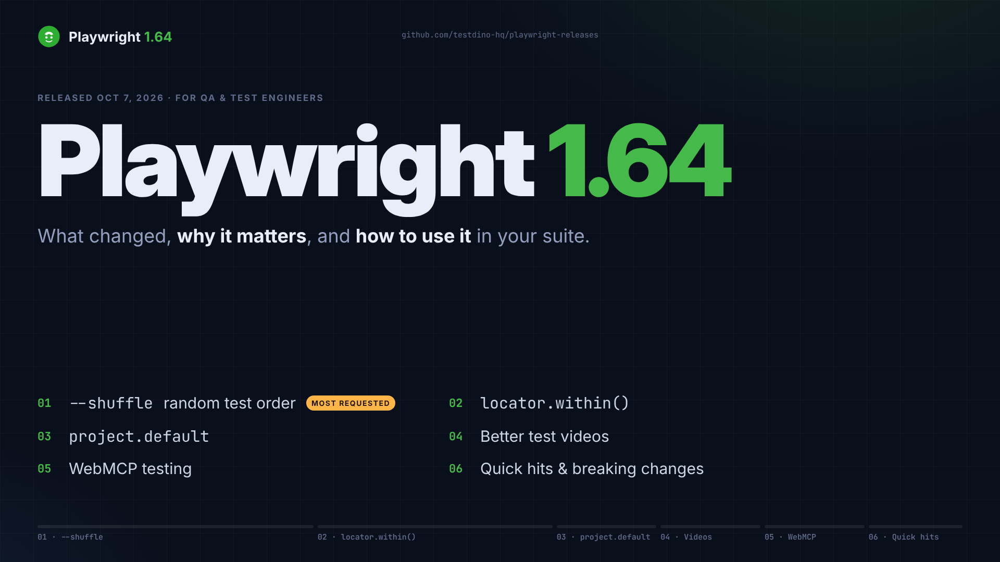
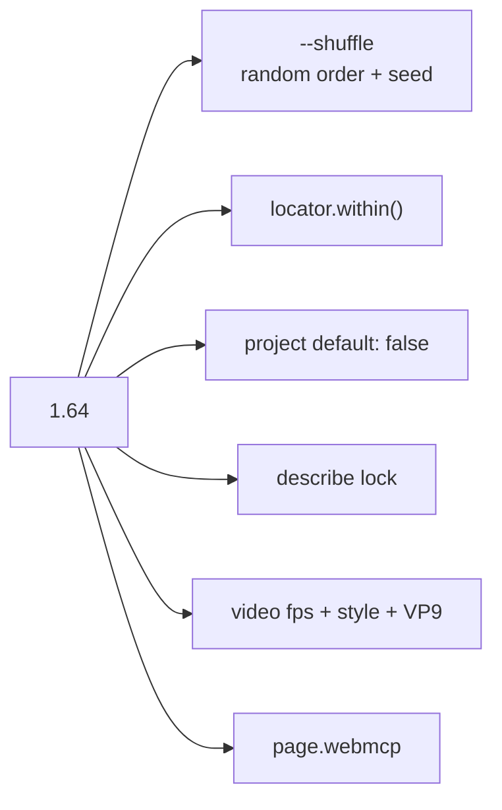
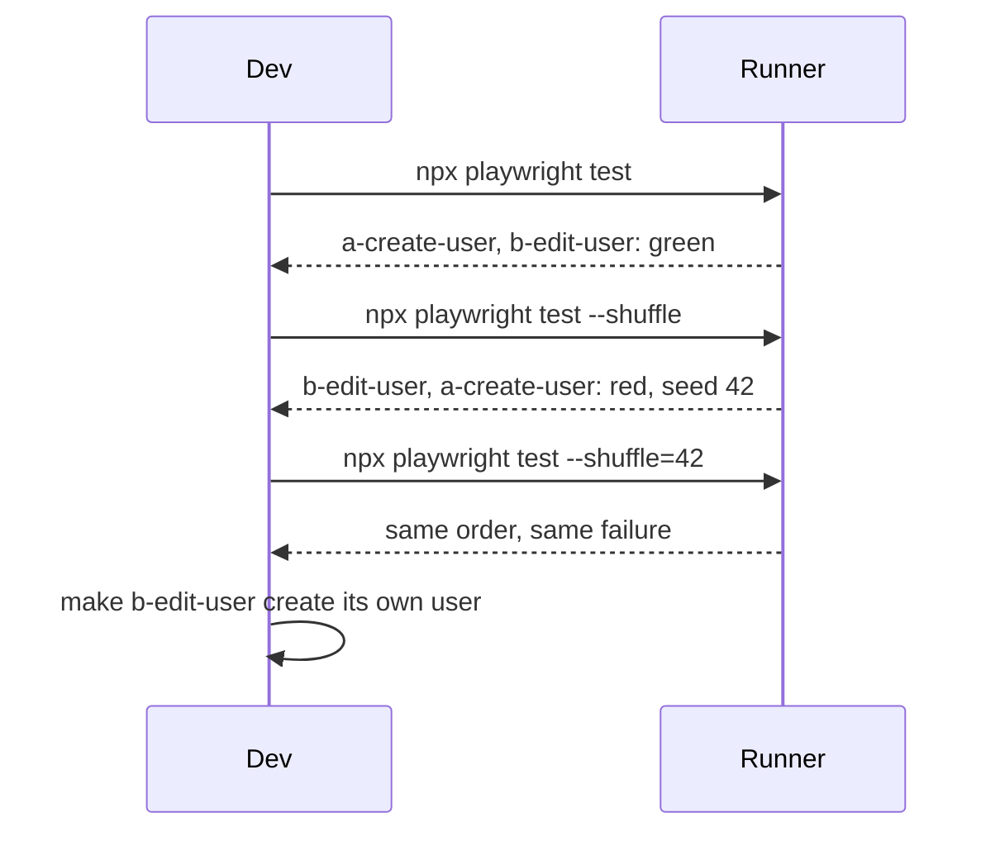

# Playwright 1.64: What's New, Explained with Runnable Examples

Playwright 1.64 (released 7 October 2026) adds `--shuffle` to run tests in random order,
`locator.within()` for per-row and per-dialog locators, `default: false` projects,
describe-level test locks, 60 fps styled test videos, and WebMCP testing with
`page.webmcp`. Every example in this folder runs against `@playwright/test@1.64.0`.

## Watch: Playwright 1.64 in 3 minutes

[](https://github.com/testdino-hq/playwright-releases/raw/main/1.64/video/playwright-1.64-whats-new.mp4)

[Play the video](https://github.com/testdino-hq/playwright-releases/raw/main/1.64/video/playwright-1.64-whats-new.mp4)
(2:53, 1080p, [mp4 in this repo](./video/playwright-1.64-whats-new.mp4)). For each feature it covers
the problem before 1.64, the new solution, and a practical use case.

| Time | Chapter | Example |
| --- | --- | --- |
| 0:00 | Intro | |
| 0:09 | `--shuffle`: catch order-dependent tests | [`01-shuffle`](./examples/tests/01-shuffle.spec.ts) |
| 0:56 | `locator.within()`: the 3rd cell of every row | [`02-locator-within`](./examples/tests/02-locator-within.spec.ts) |
| 1:36 | `project.default`: opt-in projects | [`playwright.config.ts`](./examples/playwright.config.ts) |
| 1:53 | Better test videos: fps, CSS styles, VP9 | [`07-video-fps`](./examples/tests/07-video-fps.spec.ts) |
| 2:10 | WebMCP: test the tools your site gives AI agents | [`shop.webmcp`](./examples/tests/shop.webmcp.spec.ts) |
| 2:27 | Quick hits and breaking changes | [`10-breaking-changes`](./examples/tests/10-breaking-changes.spec.ts) |
| 2:43 | Upgrade | |

## Run

```bash
cd examples
npm install
npx playwright install chromium
npm test          # 29 passed
```

One feature at a time:

```bash
npm run shuffle:demo:ordered   # 2 order-dependent tests pass in file order
npm run shuffle:demo           # the same tests with --shuffle=42: 1 fails, every time
npm run shuffle                # whole suite in random order, prints the seed
npm run within     npm run lock      npm run ref       npm run shadow
npm run cookies    npm run video     npm run passkeys  npm run snapshots
npm run breaking   npm run webmcp    npm run all       # --project=*
```

## What changed in 1.64

### 1. `--shuffle`: run Playwright tests in random order (most requested)

- **Problem:** Playwright always ran files in the same order, so a test that only passes because
  another test ran first (leftover DB rows, a shared account, module state) stays green for months
  and breaks the day you shard CI. Requested since 2021 in
  [#7040](https://github.com/microsoft/playwright/issues/7040),
  [#9297](https://github.com/microsoft/playwright/issues/9297) and
  [#12512](https://github.com/microsoft/playwright/issues/12512).
- **Solution:** `npx playwright test --shuffle` randomizes files, and tests in `fullyParallel` mode.
  The seed is printed and stored in `config.metadata.shuffleSeed`; `--shuffle=<seed>` replays the
  exact order. Serial suites and project dependencies keep their order.
  ([PR #42877](https://github.com/microsoft/playwright/pull/42877))
- **Use case:** [`tests-order-dependent/`](./examples/tests-order-dependent) holds two files where
  `b-edit-user` silently needs `a-create-user`. File order passes, `--shuffle=42` fails with
  `this test silently depends on a-create-user.spec.ts`. Add `--shuffle` to a nightly job and keep the seed of any red run.

### 2. `locator.within()`: nth() per parent, not per page

- **Problem:** `rows.getByRole('cell').nth(2)` is the 3rd cell of the whole table. Asserting a column
  meant a loop or a brittle `td:nth-child(3)` selector ([#42842](https://github.com/microsoft/playwright/issues/42842)).
- **Solution:** `page.getByRole('cell').nth(2).within(rows)` is the 3rd cell of every row.
  ([PR #42887](https://github.com/microsoft/playwright/pull/42887))
- **Use case:** `await expect(column).toHaveText(['Apple', 'Banana', 'Cherry'])`, or click the
  Refund button inside one specific row.

### 3. `default: false` projects

- **Problem:** Slow or special projects (cross-browser, nightly, demo) ran on every plain
  `npx playwright test` unless you wrapped them in env vars.
- **Solution:** `default: false` skips a project unless `--project=<name>` or `--project="*"`
  selects it, or another running project depends on it. Reporters and global setup see the
  selection in `config.filteredProjects`. ([PR #42750](https://github.com/microsoft/playwright/pull/42750))
- **Use case:** the `order-dependent` project in [`playwright.config.ts`](./examples/playwright.config.ts)
  fails on purpose, so it is opt-in. [`selected-projects-reporter.ts`](./examples/reporters/selected-projects-reporter.ts)
  prints what ran.

### 4. `test.describe.configure({ lock })`

- **Problem:** 1.63 test locks had to be repeated on every test. Forget one and the shared
  resource races again ([#42782](https://github.com/microsoft/playwright/issues/42782)).
- **Solution:** declare the lock once per file or describe block.
- **Use case:** [`03-describe-lock`](./examples/tests/03-describe-lock.spec.ts): three tests on a shared
  inbox never overlap. Comment out the lock and two of them fail.

### 5. Test videos: `fps`, CSS `style`, VP9

- **Problem:** choppy videos with a fixed highlight style, fine for debugging but not for a bug
  report or a demo.
- **Solution:** `video: { mode: 'on', fps: 60, show: { actions: { style: { point, highlight, title } } } }`.
  VP9 encoding, smaller files. The cursor stays on screen. `fontSize` is deprecated.
- **Use case:** [`07-video-fps`](./examples/tests/07-video-fps.spec.ts) records a 1280x720 VP9 video at 60 fps
  (checked with `ffprobe`). Open it with `npm run report`.

### 6. WebMCP: `page.webmcp.tools()` and `callTool()`

- **Problem:** tools a page registers for AI agents are a public API with no UI. A renamed tool or a
  drifting schema breaks agents and no click-based test notices.
- **Solution:** list and call them from tests. Chromium only, behind `--enable-features=WebMCP`.
  Playwright MCP exposes them as `webmcp_<tool>`; `playwright-cli` adds `webmcp-list` and `webmcp-call`.
- **Use case:** [`shop.webmcp.spec.ts`](./examples/tests/shop.webmcp.spec.ts): contract test on names,
  descriptions and schemas, then call `add_to_cart` and assert the cart the user sees.

### Smaller APIs

| Spec | API | Shows |
| --- | --- | --- |
| [`04-get-by-ref`](./examples/tests/04-get-by-ref.spec.ts) | `page.getByRef()` | Act on an aria-snapshot ref, normalize it to `getByRole(...)`. |
| [`05-content-include-shadow`](./examples/tests/05-content-include-shadow.spec.ts) | `content({ includeShadow })` | Save web-component pages with their shadow content. |
| [`06-api-request-cookies`](./examples/tests/06-api-request-cookies.spec.ts) | `request.cookies()` and friends | Read, seed and clear API cookies. |
| [`08-passkey-sign-count`](./examples/tests/08-passkey-sign-count.spec.ts) | `credentials.create({ signCount })` | Counter that continues, and survives storage state. |
| [`09-webp-screenshots-and-missing-snapshots`](./examples/tests/09-webp-screenshots-and-missing-snapshots.spec.ts) | `toHaveScreenshot.type`, `updateSnapshots: 'missing'` | WebP baselines for unnamed screenshots; first run is green. |

## Upgrade or skip

| Situation | Verdict |
| --- | --- |
| Flaky suite, suspected test coupling | Upgrade. Run `--shuffle` nightly. |
| Table or list heavy UI | Upgrade. `within()` replaces loops and `nth-child`. |
| Site exposes WebMCP tools | Upgrade. |
| Tests use `devices[...]` and branch on `window.screen` | Check. `screen` is now forwarded. Opt out with `screen: undefined`. |
| Tests assert visibility inside collapsed iframes | Check. Hidden iframe content is now hidden. |
| CI uses `--update-snapshots=missing` to fail on new baselines | Change to `--update-snapshots=default`. `missing` now passes. |
| JSX in test files on the classic runtime | Check. JSX follows `tsconfig.json`, automatic runtime by default. |
| None of the above | Skip. Revisit at 1.65. |

## Notes

- `--shuffle tests/foo.spec.ts` reads the path as the seed
  ([#43156](https://github.com/microsoft/playwright/issues/43156)). Write `--shuffle=<seed>` or put `--shuffle` last.
- WebMCP needs a secure origin (https or localhost) and `document.modelContext`. Chromium replaces a
  tool's own error message with "Tool was executed but the invocation failed".
- WebMCP annotations: `readOnlyHint` in the page is reported as `readOnly`.
- `toHaveScreenshot` still defaults to PNG. WebP needs `expect.toHaveScreenshot.type: 'webp'`.
- `--reporter` on the CLI replaces config reporters, so the seed and project lines disappear.
- Browsers: Chromium 156.0.8078.4, Firefox 157.0, WebKit 27.2. Tested with Chrome 155 and Edge 155.
- Visual baselines are gitignored. The first run writes them.

## FAQ

**What is new in Playwright 1.64?**
Random test order with `--shuffle`, `locator.within()`, `default: false` projects, describe-level
locks, 60 fps styled VP9 test videos, WebMCP testing, `page.getByRef()`, API request cookie methods,
`content({ includeShadow })`, and passkey `signCount`.

**How do I run Playwright tests in random order?**
`npx playwright test --shuffle`. Replay a failing order with `npx playwright test --shuffle=<seed>`,
using the seed from the "Running N tests" line.

**How do I select the nth cell in every table row in Playwright?**
`page.getByRole('cell').nth(n).within(page.getByRole('row'))`, available from 1.64.

**How do I stop a Playwright project from running by default?**
Set `default: false` on the project. Run it with `--project=<name>` or `--project="*"`.

**How do I test WebMCP tools with Playwright?**
Launch Chromium with `--enable-features=WebMCP`, then use `page.webmcp.tools()` and
`page.webmcp.callTool(name, input)`.

**Does Playwright 1.64 have breaking changes?**
Yes: device `screen` is forwarded, hidden iframe content is hidden, `--update-snapshots=missing`
now passes, and JSX in tests follows `tsconfig.json`.

## Links

- [Release notes](https://playwright.dev/docs/release-notes#version-164)
- [GitHub release v1.64.0](https://github.com/microsoft/playwright/releases/tag/v1.64.0)
- [`locator.within()`](https://playwright.dev/docs/api/class-locator#locator-within)
- [WebMCP class](https://playwright.dev/docs/api/class-webmcp)
- [Playwright Skill guides updated for 1.64](https://github.com/testdino-hq/playwright-skill)

---

## Diagrams

### What shipped



### Finding a hidden dependency with --shuffle


